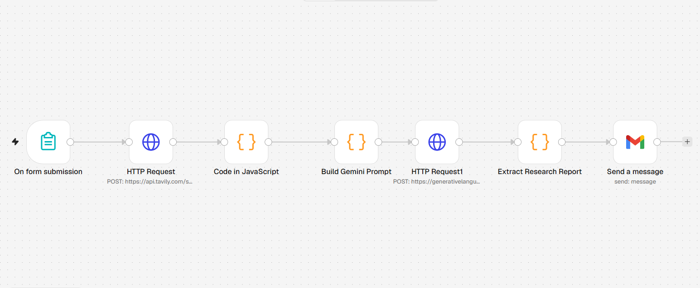
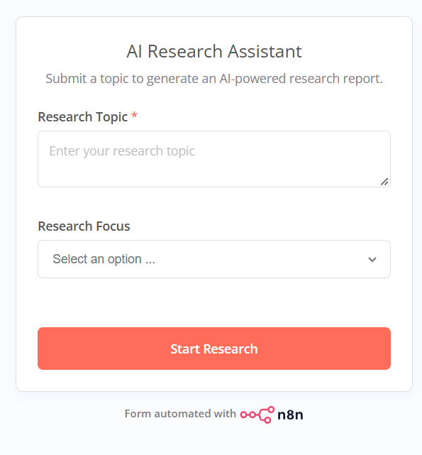

# AI Research & Reporting Agent

An automated AI-powered research assistant built with **n8n, Tavily, Google Gemini, and Gmail**.

It accepts a research topic, searches the web for relevant information, generates a structured research report using Google Gemini, and automatically delivers the report through email.

## 🚀 Live Demo

**To Try the application:** Send mail for the research form link

Submit a research topic and receive an AI-generated research report by email.

## ✨ Features

- **Research Input:** Accepts research topics and specific research focus through an online form.
- **Web Search:** Uses Tavily API to retrieve relevant web sources.
- **Source Processing:** Extracts and structures research results before passing them to the AI model.
- **AI Report Generation:** Uses Google Gemini to generate structured research reports.
- **Automated Email Delivery:** Sends the completed report through Gmail.
- **Source References:** Includes source URLs in the generated report.

## 🏗️ Workflow Architecture

```text
Research Form
     |
     v
Tavily Web Search
     |
     v
Prepare Research Sources
     |
     v
Build Gemini Prompt
     |
     v
Google Gemini API
     |
     v
Extract & Format Report
     |
     v
Gmail - Send Report
```

## 🛠️ Technology Stack

| Technology | Purpose |
|---|---|
| n8n | Workflow automation and orchestration |
| Tavily API | Web research and information retrieval |
| Google Gemini API | AI-powered report generation |
| Gmail API | Automated report delivery |
| JavaScript | Data processing and prompt construction |


## 📸 Project Screenshots

### Workflow Overview



### Research Input Form



### Email Delivery


## ⚙️ How It Works

1. A user submits a research topic and research focus through the public form.
2. Tavily searches the web and retrieves relevant research sources.
3. JavaScript nodes filter and structure the retrieved information.
4. A research prompt is constructed using the collected sources.
5. Google Gemini analyzes the supplied information and generates a structured report.
6. The report is extracted and formatted into HTML.
7. Gmail automatically delivers the completed report to the specified recipient.

## 💻 Run Your Own Instance

### Prerequisites

- An n8n instance (Cloud or self-hosted).
- Tavily API key.
- Google Gemini API key.
- Gmail account with the required n8n connection.

### Setup

1. Clone this repository:

   ```bash
   git clone https://github.com/zahid0511/ai-research-reporting-agent.git
   ```

2. Open your n8n instance.

3. Import `workflow/ai-research-agent.json`.

4. Configure the required credentials:
   - Tavily API authentication.
   - Google Gemini API authentication.
   - Gmail OAuth2 authentication.

5. Verify the API connections and execute the workflow.

6. Configure and activate the Form Trigger to obtain your own production form URL.

**Note:** API keys and OAuth credentials are not included in the exported workflow. You must configure your own credentials.

## 🔐 Security

- API keys are stored in n8n credentials, not hardcoded in the workflow.
- OAuth credentials must be configured by each user.
- Never commit API keys, passwords, access tokens, or private configuration files.

## 🔮 Future Improvements

- Multiple search queries and source aggregation.
- Improved source deduplication and relevance ranking.
- PDF report generation.
- Retry mechanisms and error handling.
- Report history and research execution tracking.
- Rate limiting for public form submissions.

## 👨‍💻 Author

**MD Zahid**

B.Tech in Computer Science and Engineering

- GitHub: [@zahid0511](https://github.com/zahid0511)

---

*Built to demonstrate practical AI integration, API orchestration, and workflow automation using n8n.*
